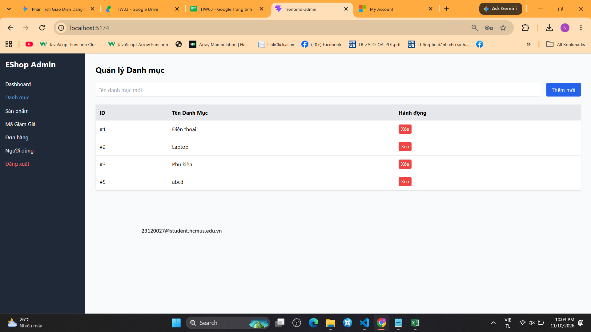
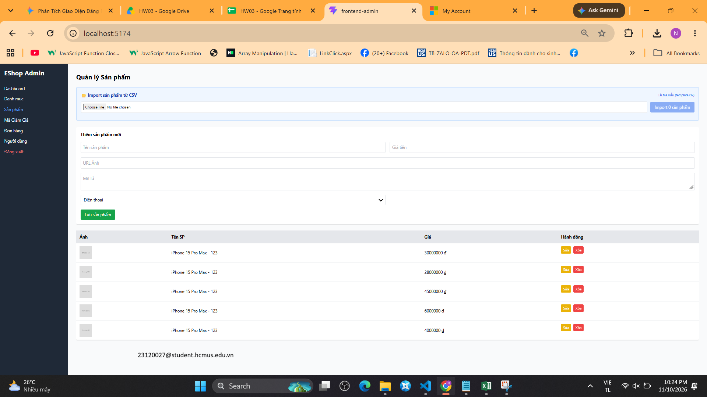

## [GUI] [BUG-40] [FR-14] Danh mục sau khi thêm không dùng đúng số thứ tự 
- Checklist: CHK-CAT-13
- Mô tả: Sau khi xóa rồi thêm danh mục mới sẽ dùng số tiếp theo so với danh mục đã bị xóa
- Các bước thực hiện: B1: Thêm danh mục mới là abc sau đó xóa đi. B2: Thêm danh mục mới. Danh mục mới sẽ sử dụng số thứ tự tiếp theo số thứ tự danh mục vừa xóa.
- Bằng chứng: 
- Github issues: 

## [GUI] [BUG-41] [FR-15] Sửa tên sản phẩm thì tất cả sản phẩm đều bị đổi theo
 - Checklist: CHK-PROD-09
- Mô tả: Sau khi sửa tên sản phẩm và lưu thì tất cả các sản phẩm khác cũng bị thay đổi theo
- Các bước thực hiện: B1: Bấm vào nút sửa trên sản phẩm iPhone 15 Pro Max. B2: Sửa tên thành iPhone 15 Pro Max - 123 rồi bấm lưu
- Bằng chứng:  
- Github issues: 

