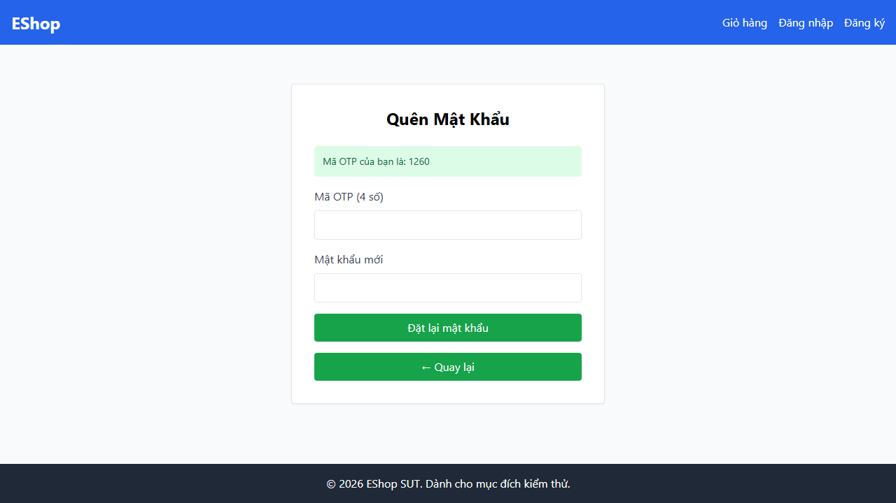
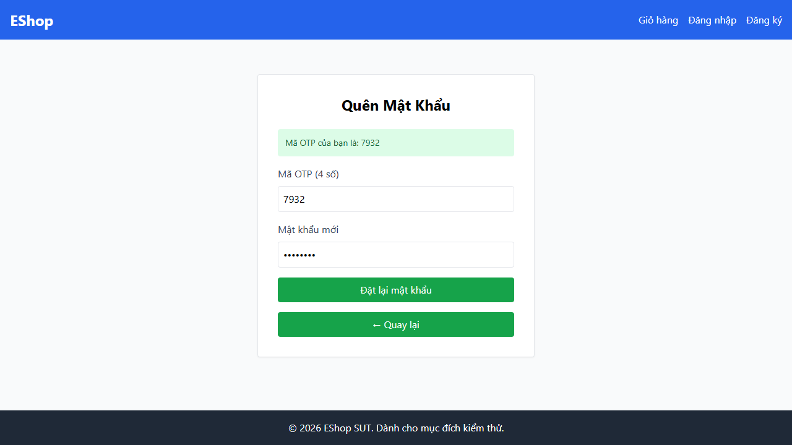
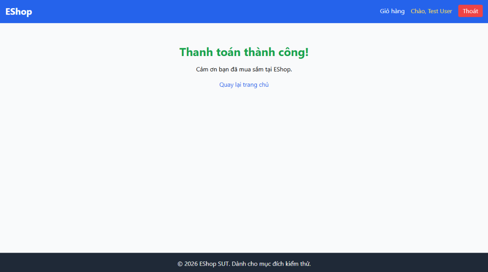
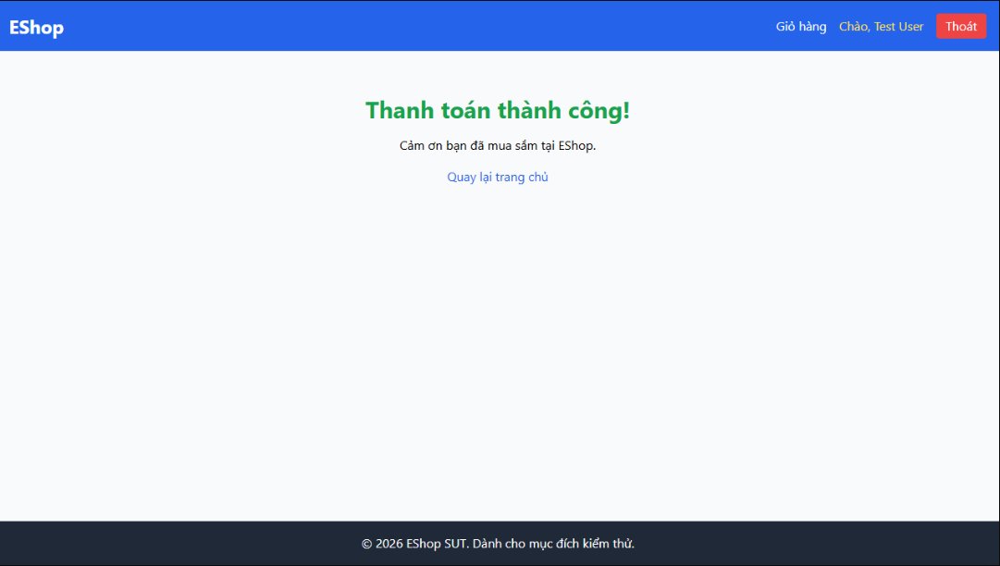
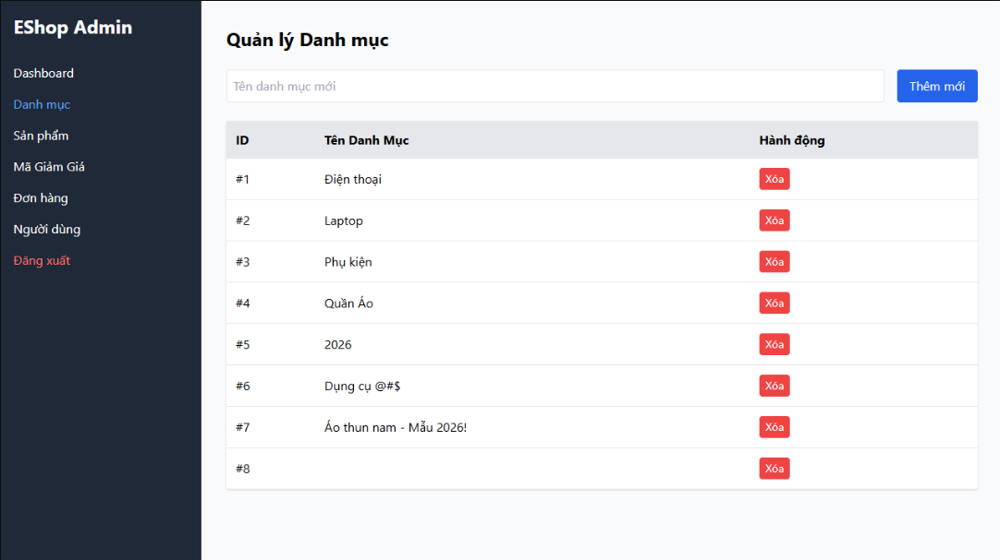
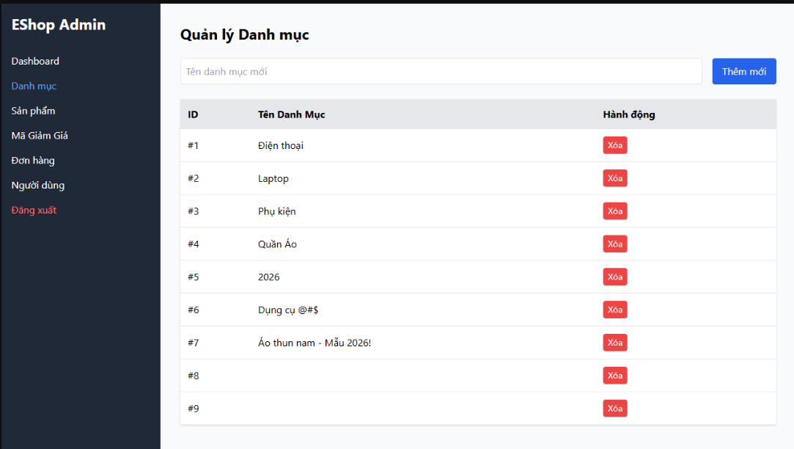
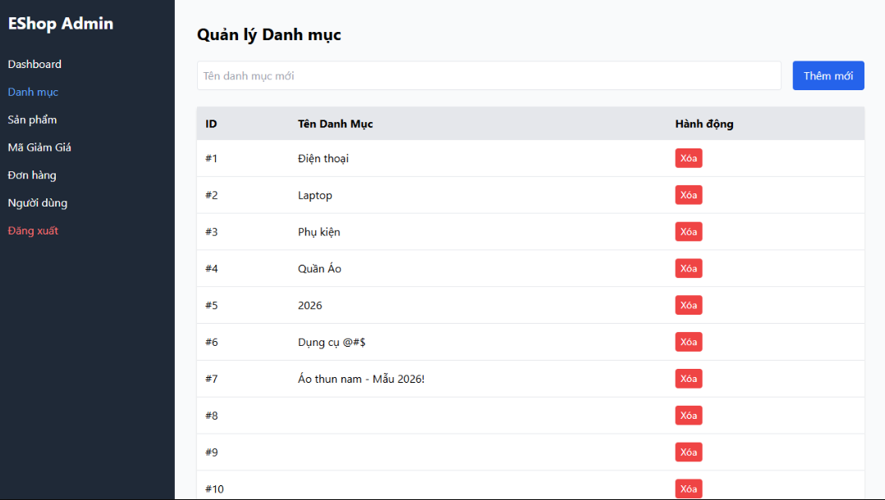
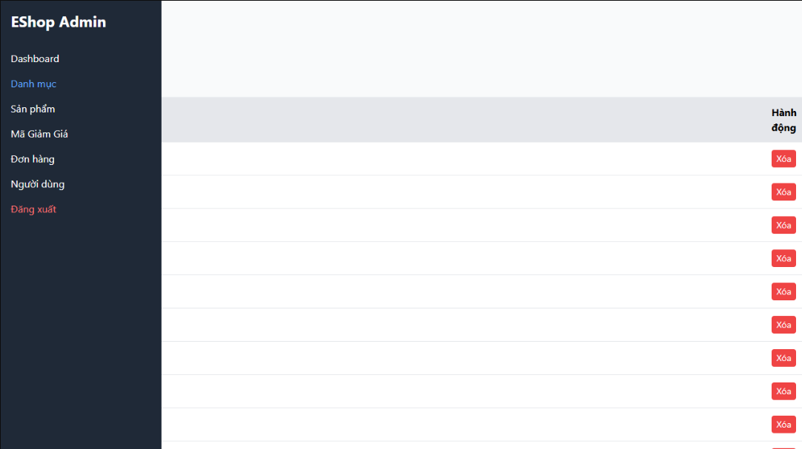

# Bug Report

## BUG-01: Hệ thống không xử lý đúng email không hợp lệ

- **Feature:** FR-03 Forgot password
- **Test Case ID:** TC02, TC03, TC05, BVA_EM_03, BVA_EM_05, BVA_EM_06
- **GitHub Issue:** https://github.com/stardust65613/eshop_sut/issues/1

### Steps to Reproduce
1. Bấm quên mật khẩu
2. Nhập email không hợp lệ
3. Bấm Lấy mã OTP

### Expected Result
Không chuyển đến trang nhập OTP, mật khẩu mới.

### Actual Result
Chuyển đến trang nhập OTP, mật khẩu mới.

### Screenshot

## BUG-02: Hệ thống không xử lý đổi mật khẩu dù OTP và mật khẩu đã nhập đúng

- **Feature:** FR-03 Forgot password
- **Test Case ID:** TC01
- **GitHub Issue:** https://github.com/stardust65613/eshop_sut/issues/2

### Steps to Reproduce
1. Bấm quên mật khẩu
2. Nhập email test@gmail.com
3. Bấm Lấy mã OTP
4. Nhập mã OTP hiện trên màn hình
5. Nhập mật khẩu: Abc@1234

### Expected Result
Mật khẩu cập nhật, trả về trang login

### Actual Result
Không đổi được mật khẩu, vẫn ở trang đổi mật khẩu. 

### Screenshot

## BUG-03: Hệ thống không tính lại tổng tiền đơn hàng khi người dùng thay đổi giá trị trên giao diện

- **Feature:** FR-08 – Checkout
- **Test Case ID:** TC_02
- **GitHub Issue:** https://github.com/stardust65613/eshop_sut/issues/3

### Steps to Reproduce
1. Đăng nhập bằng tài khoản người dùng.
2. Thêm sản phẩm vào giỏ hàng.
3. Truy cập trang Checkout.
4. Thay đổi giá trị tổng tiền trên giao diện thành giá trị khác.
5. Nhấn **Xác Nhận Thanh Toán**.
6. Kiểm tra tổng tiền của đơn hàng được lưu trong hệ thống.

### Expected Result
Hệ thống phải tự tính toán lại tổng tiền dựa trên giá sản phẩm và số lượng thực tế, không sử dụng giá trị tổng tiền do người dùng tự thay đổi trên giao diện.

**Expected Total:** 58.000.000 VND

### Actual Result
Đơn hàng được tạo thành công nhưng tổng tiền được lưu trong hệ thống không khớp với tổng tiền mong đợi.

- **Expected:** 58.000.000 VND
- **Actual:** 50.000.000 VND

### Playwright Test Result
- **Test Status:** Failed
- **Assertion:** `expect(Number(order.total_amount)).toBe(expected.total)`
- **Expected:** `58000000`
- **Received:** `50000000`

### Screenshot

## BUG-04: Hệ thống chấp nhận thanh toán với giá trị số âm

- **Feature:** FR-08 – Checkout
- **Test Case ID:** TC_05
- **GitHub Issue:** https://github.com/stardust65613/eshop_sut/issues/4

### Steps to Reproduce
1. Đăng nhập bằng tài khoản người dùng.
2. Thêm sản phẩm vào giỏ hàng.
3. Truy cập trang Checkout.
4. Nhập giá trị tổng tiền âm.
5. Nhấn **Xác Nhận Thanh Toán**.

### Expected Result
Hệ thống từ chối giá trị âm, không tạo đơn hàng và trả về HTTP Status 400 trở lên.

### Actual Result
Hệ thống chấp nhận thanh toán và tạo đơn hàng thành công.

- **Expected Status:** >= 400
- **Received Status:** 200

### Playwright Test Result
- **Test Status:** Failed
- **Assertion:** `toBeGreaterThanOrEqual()`
- **Expected:** `400`
- **Received:** `200`

### Screenshot

## BUG-05: Backend không tự tính toán lại tổng tiền khi người dùng gửi giá trị 0

- **Feature:** FR-08 – Checkout
- **Test Case ID:** TC_06
- **GitHub Issue:** https://github.com/stardust65613/eshop_sut/issues/5

### Steps to Reproduce
1. Đăng nhập bằng tài khoản người dùng.
2. Thêm sản phẩm vào giỏ hàng.
3. Truy cập trang Checkout.
4. Thay đổi tổng tiền thành `0`.
5. Nhấn **Xác Nhận Thanh Toán**.
6. Kiểm tra tổng tiền của đơn hàng được lưu trong hệ thống.

### Expected Result
Backend phải tự tính toán tổng tiền dựa trên giá sản phẩm và số lượng thực tế trong giỏ hàng, không sử dụng giá trị `0` do người dùng gửi lên.

**Expected Total:** 58.000.000 VND

### Actual Result
Đơn hàng được tạo thành công nhưng tổng tiền được lưu trong hệ thống là `0`, không khớp với tổng tiền thực tế của giỏ hàng.

**Expected:** 58.000.000 VND  
**Actual:** 0 VND

### Playwright Test Result
- **Test Status:** Failed
- **Assertion:** `expect(Number(order.total_amount)).toBe(expected.total)`
- **Expected:** 58000000
- **Received:** 0

### Screenshot

## BUG-06: Backend không kiểm soát tổng tiền khi người dùng nhập giá trị thập phân

- **Feature:** FR-08 – Checkout
- **Test Case ID:** TC_07
- **GitHub Issue:** https://github.com/stardust65613/eshop_sut/issues/6

### Steps to Reproduce
1. Đăng nhập bằng tài khoản người dùng.
2. Thêm sản phẩm vào giỏ hàng.
3. Truy cập trang Checkout.
4. Nhập giá trị tổng tiền thập phân.
5. Nhấn **Xác Nhận Thanh Toán**.
6. Kiểm tra tổng tiền của đơn hàng được lưu trong hệ thống.

### Expected Result
Backend phải tự tính toán tổng tiền dựa trên giá sản phẩm và số lượng thực tế trong giỏ hàng, không sử dụng giá trị tổng tiền do người dùng tự nhập.

**Expected Total:** 58.000.000 VND

### Actual Result
Đơn hàng được tạo thành công nhưng tổng tiền được lưu trong hệ thống là giá trị thập phân do người dùng nhập, không khớp với tổng tiền thực tế.

**Expected:** 58.000.000 VND  
**Actual:** 363.632,18282828 VND

### Playwright Test Result
- **Test Status:** Failed
- **Assertion:** `expect(Number(order.total_amount)).toBe(expected.total)`
- **Expected:** 58000000
- **Received:** 363632.18282828

### Screenshot

Các test case TC_BVA_01, TC_BVA_02, TC_BVA_03, TC_BVA_04, TC_BVA_05 cũng có lỗi tương tự: backend không dùng giá trị đúng khi thanh toán mà dùng giá trị người dùng nhập.

## BUG-07: Backend chấp nhận giá trị tổng tiền vượt giới hạn

- **Feature:** FR-08 – Checkout
- **Test Case ID:** TC_BVA_06
- **GitHub Issue:** https://github.com/stardust65613/eshop_sut/issues/7 

### Steps to Reproduce
1. Đăng nhập bằng tài khoản người dùng.
2. Thêm sản phẩm vào giỏ hàng.
3. Truy cập trang Checkout.
4. Nhập chuỗi số có độ dài cực lớn vào trường tổng tiền.
5. Nhấn **Xác Nhận Thanh Toán**.

### Expected Result
Hệ thống phải kiểm tra giới hạn và tính hợp lệ của giá trị đầu vào, từ chối giá trị vượt giới hạn kỹ thuật và không tạo đơn hàng.

**Expected Status:** HTTP 400 trở lên.

### Actual Result
Hệ thống chấp nhận yêu cầu thanh toán và trả về HTTP 200. Giao diện hiển thị thông báo thanh toán thành công.

**Expected Status:** >= 400  
**Actual Status:** 200

### Playwright Test Result
- **Test Status:** Failed
- **Assertion:** `toBeGreaterThanOrEqual()`
- **Expected:** >= 400
- **Received:** 200

### Screenshot

## BUG-08: Hệ thống xử lý không đúng khi thêm danh mục với chuỗi ký tự cực lớn

- **Feature:** FR-14 – Category Management
- **Test Case ID:** TC_ADD_CAT_05_AND_BVA_05
- **GitHub Issue:** https://github.com/stardust65613/eshop_sut/issues/8 

### Steps to Reproduce
1. Đăng nhập bằng tài khoản Admin.
2. Truy cập trang Quản lý Danh mục.
3. Nhập hoặc copy/paste chuỗi gồm 10.000 ký tự `A` vào trường Tên danh mục mới.
4. Nhấn **Thêm mới**.
5. Kiểm tra danh sách danh mục.

### Expected Result
Hệ thống phải xử lý chuỗi đầu vào cực lớn một cách ổn định, không làm giao diện bị crash hoặc tạo dữ liệu sai lệch.

### Actual Result
Danh mục không được hiển thị đúng tên trong bảng. Bảng xuất hiện một dòng danh mục mới nhưng tên danh mục bị trống.

### Playwright Test Result
- **Test Status:** Failed
- **Assertion:** `toBeVisible()`
- **Expected:** Dòng danh mục chứa 10.000 ký tự `A` hiển thị.
- **Actual:** Không tìm thấy dòng danh mục tương ứng.

### Screenshot

## BUG-09: Hệ thống cho phép thêm danh mục với tên để trống

- **Feature:** FR-14 – Category Management
- **Test Case ID:** TC_ADD_CAT_06_AND_BVA_01
- **GitHub Issue:** https://github.com/stardust65613/eshop_sut/issues/9 

### Steps to Reproduce
1. Đăng nhập bằng tài khoản Admin.
2. Truy cập trang Quản lý Danh mục.
3. Để trống trường Tên danh mục mới.
4. Nhấn **Thêm mới**.
5. Kiểm tra danh sách danh mục.

### Expected Result
Hệ thống phải từ chối thêm danh mục khi tên bị bỏ trống và hiển thị thông báo validation phù hợp. Số lượng danh mục không thay đổi.

### Actual Result
Hệ thống vẫn tạo danh mục mới dù tên bị bỏ trống. Một dòng danh mục không có tên xuất hiện trong bảng.

### Playwright Test Result
- **Test Status:** Failed
- **Assertion:** `toHaveCount()`
- **Expected:** 8
- **Received:** 9

### Screenshot

## BUG-10: Hệ thống cho phép thêm danh mục với tên chỉ chứa khoảng trắng

- **Feature:** FR-14 – Category Management
- **Test Case ID:** TC_ADD_CAT_07
- **GitHub Issue:** https://github.com/stardust65613/eshop_sut/issues/10 

### Steps to Reproduce
1. Đăng nhập bằng tài khoản Admin.
2. Truy cập trang Quản lý Danh mục.
3. Nhập tên danh mục chỉ chứa các ký tự khoảng trắng (ví dụ: `"   "`).
4. Nhấn **Thêm mới**.
5. Kiểm tra danh sách danh mục.

### Expected Result
Hệ thống phải từ chối thêm danh mục nếu tên chỉ chứa khoảng trắng và hiển thị thông báo validation phù hợp. Số lượng danh mục không thay đổi.

### Actual Result
Hệ thống có dấu hiệu vẫn tạo thêm một danh mục dù tên chỉ chứa khoảng trắng. Một dòng danh mục không có tên xuất hiện trong bảng.

### Playwright Test Result
- **Test Status:** Failed
- **Assertion:** `toHaveCount()`
- **Expected:** 9
- **Received:** 10

### Screenshot

## BUG-11: Hệ thống cho phép xóa danh mục đang chứa sản phẩm

- **Feature:** FR-14 – Category Management
- **Test Case ID:** TC_DEL_CAT_02
- **GitHub Issue:** https://github.com/stardust65613/eshop_sut/issues/11 

### Steps to Reproduce
1. Đăng nhập bằng tài khoản Admin.
2. Truy cập trang Quản lý Danh mục.
3. Chọn danh mục đang chứa ít nhất một sản phẩm (ví dụ: Điện thoại).
4. Nhấn **Xóa** tại danh mục tương ứng.
5. Kiểm tra phản hồi API và danh sách danh mục.

### Expected Result
Hệ thống phải từ chối xóa danh mục đang chứa sản phẩm và hiển thị thông báo lỗi phù hợp. Danh mục phải được giữ nguyên trong danh sách.

### Actual Result
Hệ thống trả về HTTP 200 khi thực hiện yêu cầu xóa. Danh mục không còn xuất hiện trong danh sách, cho thấy thao tác xóa có thể đã thành công dù danh mục đang chứa sản phẩm.

### Playwright Test Result
- **Test Status:** Failed
- **Assertion:** `toBe()`
- **Expected:** 500
- **Received:** 200

### Screenshot
